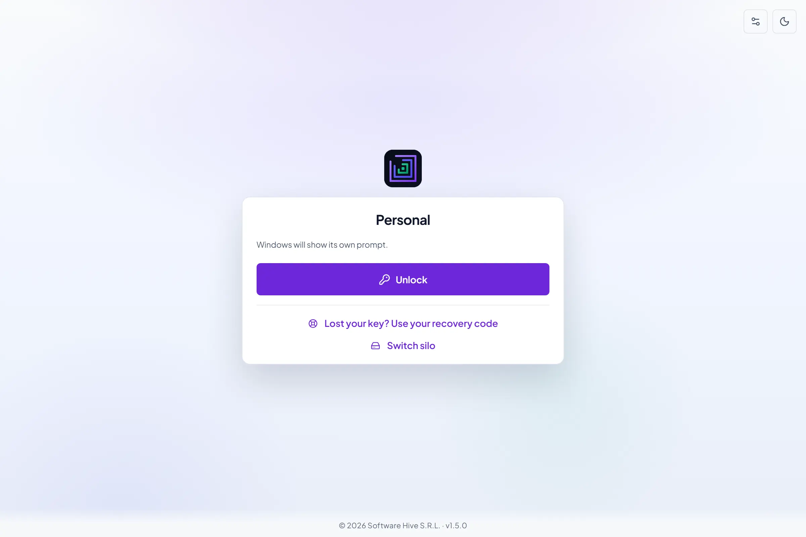
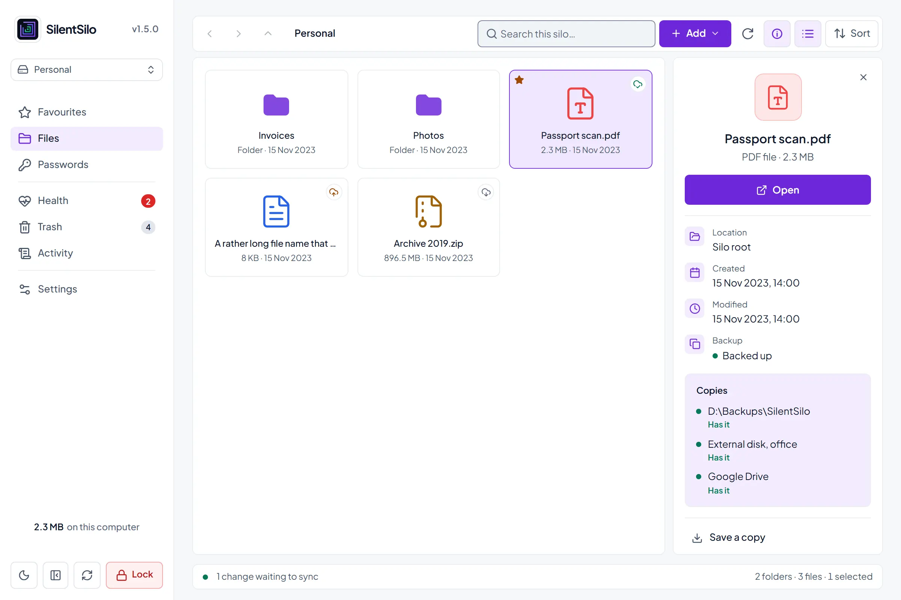
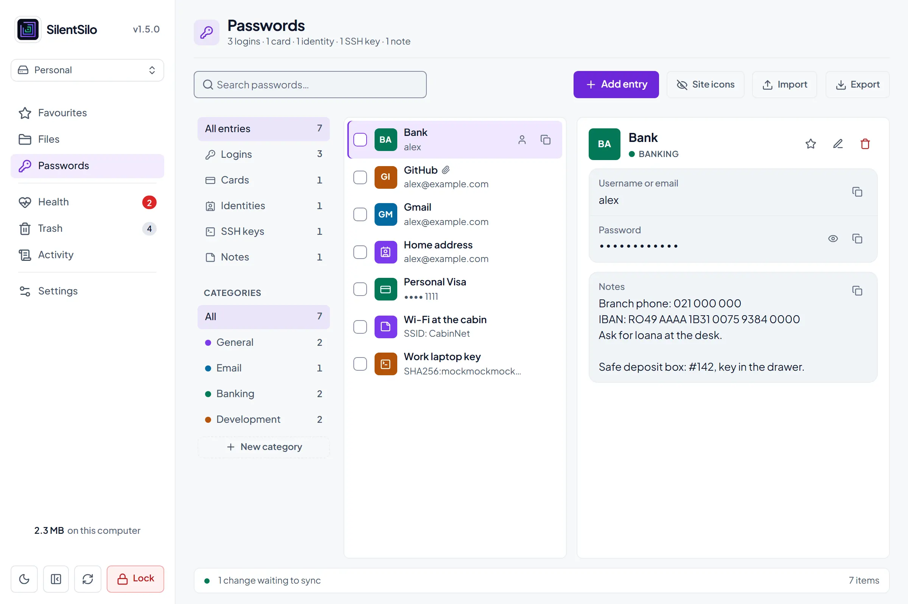
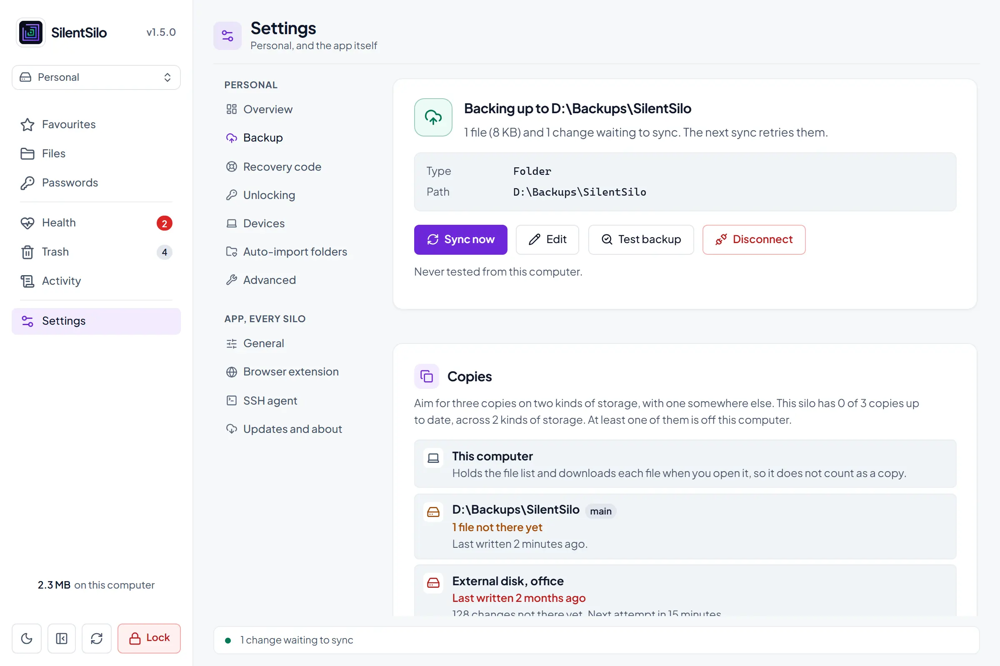

# SilentSilo

End-to-end encrypted vault for files and passwords, unlocked by a FIDO2
security key, Windows Hello (Windows 11 25H2 or later), Touch ID or a phone
over the QR code (Windows 11), with a written-down recovery code as the
fallback. For Windows 10 (version 1903 or later) and 11, macOS 13 or
later (one app for Apple silicon and Intel), and Linux as a .deb or an
AppImage on glibc 2.35 or later, such as Ubuntu 22.04 and Debian 12 (security
keys only: Linux has no built-in key the app uses). AGPL-3.0.

Everything runs locally: no SilentSilo account, no SilentSilo server. Backup
is optional, to storage you choose: your OneDrive, Dropbox or Google Drive,
iCloud Drive (on macOS and Windows), an S3-compatible bucket, a WebDAV share,
an SFTP server or a plain folder. File
contents and names are encrypted before they leave. What the storage can still
see, such as sizes, times and the name of the silo folder, is listed in
[CRYPTO.md](https://github.com/silentsilo/core/blob/main/docs/CRYPTO.md#what-the-storage-provider-learns).

Every feature is in every copy. There is no paid tier, no licence key and
nothing held back.

> **No independent security audit has been done.** Nobody outside this
> project has been paid to attack it. The cryptography is specified in
> [`docs/CRYPTO.md`](https://github.com/silentsilo/core/blob/main/docs/CRYPTO.md),
> the formats in
> [`FORMATS.md`](https://github.com/silentsilo/core/blob/main/FORMATS.md),
> the threat model and its limits are published, and all of this is readable
> here. That makes the design reviewable; it is not the same as an audit, and
> a serious flaw could sit in code that looks right and passes its tests.
> Weigh that before trusting it with something whose disclosure would be
> severe for you. When an audit happens it will be published, findings
> included.

## What it looks like

| Unlocking, with Windows Hello | The files in a silo |
|---|---|
|  |  |

| Passwords | Backup, to storage you chose |
|---|---|
|  |  |

## Stack

- Tauri 2 · Rust 1.97 · React 19 · Vite

## Where the code is

This repository holds the desktop application: the Tauri shell, the command
layer, the React frontend, and `silentsilo-shell`, which is the only crate
here that talks to the operating system.

Everything below the application lives in
[silentsilo/core](https://github.com/silentsilo/core): the cryptography, the
persisted formats, the operation log, sync, the storage backends, the
security-key backends and the standalone extraction tool. `Cargo.toml` pins a
tag from there, and the lockfile pins the commit. The phone apps
([silentsilo/mobile](https://github.com/silentsilo/mobile)) pin the same
crates.

| Crate | Role |
|-------|------|
| `silentsilo` (`src-tauri/`) | The app: commands, sessions, flows |
| `silentsilo-shell` (`crates/`) | Explorer context menu, clipboard, autostart, tray plumbing, the browser and SSH agent channels |
| `silentsilo-browser-host` (`crates/`) | The native messaging host the browser starts, which relays to the app |

The core crates are listed in the
[core README](https://github.com/silentsilo/core#readme).

## Silos

One install can hold several (personal, family, work). Each is a folder you
choose the location of, holding its own encrypted index, blobs, security-key
envelopes and credentials. Nothing is shared between them but the app, which
keeps only an index of where they are; losing that index costs you the list,
not the data.

Because everything a silo needs is inside its folder, a silo can live on an
external drive, be copied to another machine, or be restored from a backup as
a unit. Nothing decrypted is ever written there: the working copy lives in a
machine-local directory, ciphered, and files you open are wiped when the silo
locks. A silo folder is
therefore safe to put anywhere, including a folder a cloud client is syncing.

That last case works as a backup for **one** computer. It cannot serve two:
the encrypted snapshot is a single file rewritten on every change, so two
machines editing it produce a conflict copy rather than a merge. Sharing a
silo between computers is what the operation log in a bucket is for.

A silo keeps an activity log, on by default (Activity, in the sidebar;
the switch is under Settings, Devices): unlocking,
secrets shown or copied, files opened or saved outside the silo, and changes
to entries, files, keys and the recovery code. Each device encrypts its
records to the log's key before they leave it, and they are stored with the
silo's copies; a silo with no copies keeps them on the computer. Anyone who
can open a personal silo can read its log there, with any records missing
from a device named, and export it as CSV or JSON lines.

## Passwords

Logins, cards, identities, SSH keys and secure notes, each entry with its
one-time code if it has one (pasted as text, or read from a screenshot of
the site's QR code), custom fields (a hidden one is masked and copied
like a password) and its earlier versions: when a password, a field or a note
changes, the entry keeps the version before it, the last 10 by default, and
one can be put back. The generator makes random characters or random
words, and random usernames. A deleted entry waits 30 days in Recently
deleted.
Health points out reused, weak and old passwords, logins sent over
`http://`, sites that offer two-factor codes where none is saved, and an
entry back on one it had before; what is not critical can
be ignored.

Import reads a SilentSilo export (`.silopwd`), a KeePass database (`.kdbx`, with its key file if it has one),
Bitwarden's JSON or its zip with attachments, and CSV from Bitwarden, LastPass, 1Password, Proton Pass,
Dashlane, NordPass, KeePass, RoboForm and the browsers. Export writes all
entries or the selected ones to a SilentSilo file, which another SilentSilo
opens exactly as they were (every kind, setting, history and attached file),
or to a KeePass file, which KeePassXC and KeePassDX open, both under a
password you choose; or the logins alone to CSV. The browser extension fills
logins, confirmed in the app, and offers a login typed on a page for saving,
which the app asks about first; it holds nothing itself. The SSH agent lets
ssh, Git and your editor sign with the SSH keys in the silo, each use
confirmed in the app. On Windows, auto-type types a login into another program's
window with Ctrl+Alt+A, also confirmed in the app.

## Unlocking

Four ways in, all of which end up handing the vault the same encryption key:

| Method | Strength | Survives the machine |
|--------|----------|----------------------|
| FIDO2 security key | `hmac-secret` on the key | Yes, carry it with you |
| Windows Hello / Touch ID | same, held in the TPM or Secure Enclave | No, sealed to that computer |
| Phone over the QR code (Windows 11) | `hmac-secret` from the phone's passkey | Yes, it syncs with the phone's account |
| Recovery code | 160 generated bits | Yes, it's on paper |

There is deliberately **no passphrase option**. The vault is only as strong as
its weakest envelope, and a memorable phrase is around forty bits. Allowing
one would quietly make it the real security of the whole design, particularly
since envelopes are published to the bucket so other devices can join.

## Silos a company provisions

A silo can be created as administered by an organisation, only while it is
being created. The organisation's key then stays: the person using that
computer cannot remove it, change the recovery code or rotate the silo's key
without it, and every device shows it with an Organisation badge. It opens the
silo like any other key. Such a silo also keeps an activity log only the
organisation's keys read. The procedure is in
[`docs/ORGANISATIONS.md`](docs/ORGANISATIONS.md).

## Optional backup and multi-device sync

Point the app at any S3-compatible bucket you control (AWS, Backblaze B2,
Cloudflare R2, Wasabi, MinIO, …) and it will keep itself in step with your
other devices. There is no server in the middle and nothing to sign up for:
the bucket is yours, and file contents and names in it are encrypted. What
it can still see is listed in
[CRYPTO.md](https://github.com/silentsilo/core/blob/main/docs/CRYPTO.md#what-the-storage-provider-learns).

Sync is optional. A vault that never connects storage stays fully local and
fully usable.

Devices reconcile through an append-only log of operations. Every change is
one immutable object, so a push is always a create: no conditional writes,
no locking, and nothing that depends on a provider feature beyond plain
PUT/GET/LIST/DELETE. Devices that have been offline converge on the same
tree regardless of the order records arrive in.

To add a second computer, pick *Set up from backup storage* on first run,
point it at the same backup storage, and touch a key already enrolled on the
first.
Its tree is rebuilt from the latest snapshot and the records after it, and
nothing is readable in transit.

## Uninstalling

Uninstalling never touches your silo folders or your backup storage. What
stays behind on each system, and how to remove it, is in
[`docs/UNINSTALL.md`](docs/UNINSTALL.md).

## Dev

```bash
npm install
npm run tauri:dev
```

On Windows, turn on long paths for git first. Core's test fixtures name
Touch ID keys by their full id, and cargo's checkout of core passes the
260-character limit without it:

```bash
git config --global core.longpaths true
```

Working on core at the same time, the test script and the security-key
backends per system are in [CONTRIBUTING.md](CONTRIBUTING.md).

## Known gaps

See [BACKLOG.md](BACKLOG.md) for what is deliberately unfinished. No
independent security audit has been done.

## Docs

Crypto specification (public):
[`docs/CRYPTO.md`](https://github.com/silentsilo/core/blob/main/docs/CRYPTO.md),
in core

Setting up storage that survives a bad day, including append-only targets,
object lock, and the lifecycle rule that deletes your archive:
[`docs/STORAGE.md`](docs/STORAGE.md)

Persisted formats, their versions, and what an older build does when it meets
a newer one:
[`FORMATS.md`](https://github.com/silentsilo/core/blob/main/FORMATS.md), in
core

## Licence

Copyright (C) 2026 Software Hive S.R.L.

AGPL-3.0-or-later, see [LICENSE](LICENSE). Contributions are accepted under
[CLA.md](CLA.md), identical in all four SilentSilo repositories.
