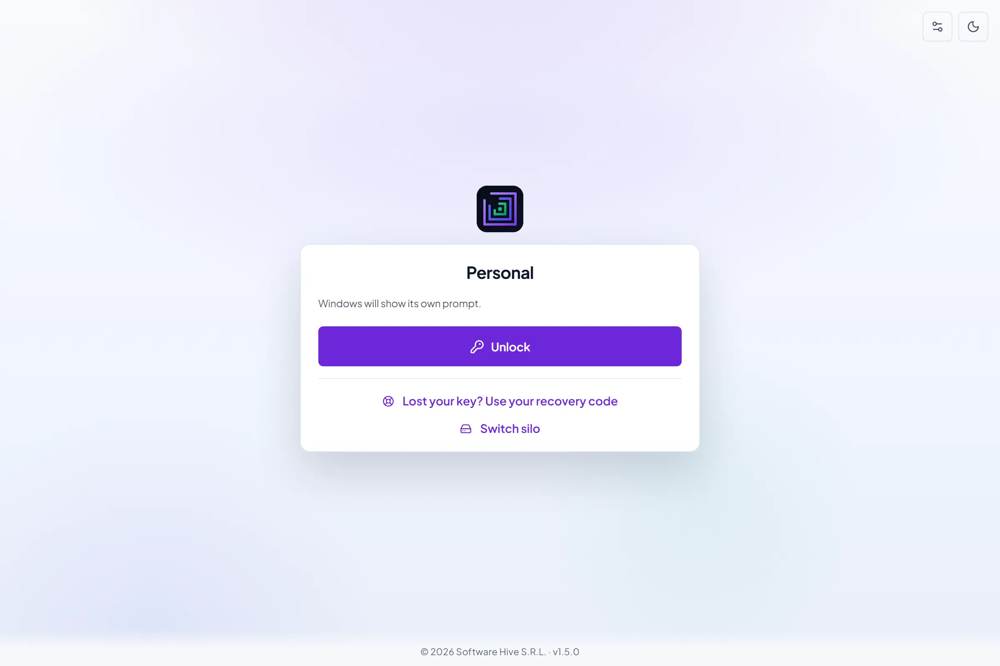
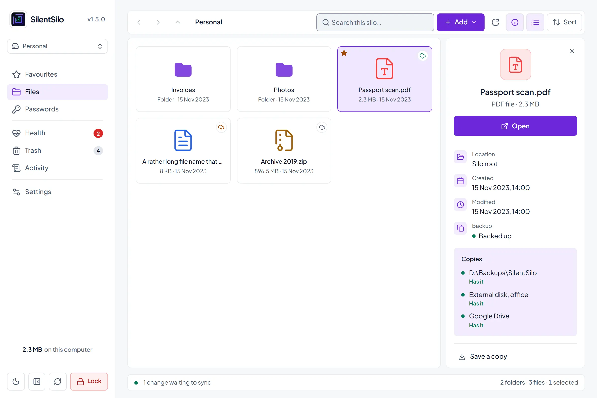
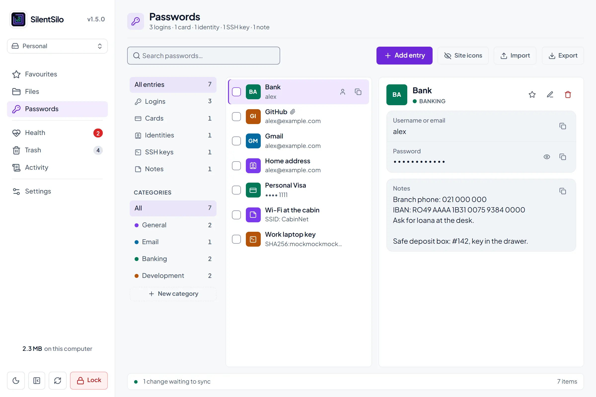
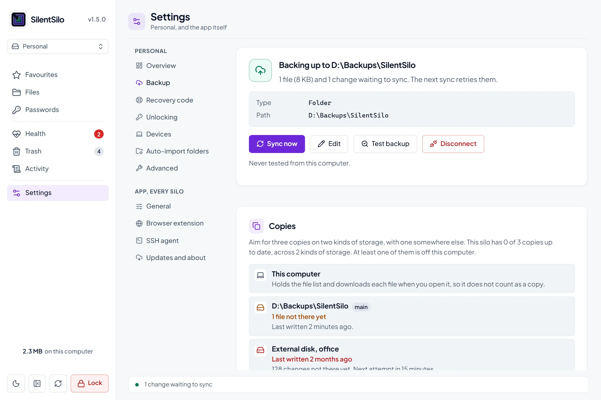

# SilentSilo

End-to-end encrypted vault for files and passwords, unlocked by a FIDO2
security key, Windows Hello, Touch ID or a phone over the QR code (Windows 11),
with a written-down recovery code as the fallback. For Windows 10 (version 1903 or later) and 11, macOS 13 or
later (one app for Apple silicon and Intel), and Linux as a .deb or an
AppImage on glibc 2.35 or later, such as Ubuntu 22.04 and Debian 12 (security
keys only: Linux has no built-in key the app uses). AGPL-3.0.

Everything runs locally: no SilentSilo account, no SilentSilo server. Backup
is optional, to storage you choose: your OneDrive, Dropbox or Google Drive,
iCloud Drive (on macOS and Windows), an S3-compatible bucket, a WebDAV share,
an SFTP server or a plain folder. File
contents and names are encrypted before they leave. What the storage can still
see, such as sizes, times and the name of the silo folder, is listed in
[CRYPTO.md](https://github.com/silentsilo/core/blob/main/docs/CRYPTO.md#what-the-storage-provider-learns).

Every feature is in every copy. There is no paid tier, no licence key and
nothing held back.

> **No independent security audit has been done.** Nobody outside this
> project has been paid to attack it. The cryptography is specified in
> [`docs/CRYPTO.md`](https://github.com/silentsilo/core/blob/main/docs/CRYPTO.md),
> the formats in
> [`FORMATS.md`](https://github.com/silentsilo/core/blob/main/FORMATS.md),
> the threat model and its limits are published, and all of this is readable
> here. That makes the design reviewable; it is not the same as an audit, and
> a serious flaw could sit in code that looks right and passes its tests.
> Weigh that before trusting it with something whose disclosure would be
> severe for you. When an audit happens it will be published, findings
> included.

## What it looks like

| Unlocking, with Windows Hello | The files in a silo |
|---|---|
|  |  |

| Passwords | Backup, to storage you chose |
|---|---|
|  |  |

## Stack

- Tauri 2 · Rust 1.97 · React 19 · Vite

## Where the code is

This repository holds the desktop application: the Tauri shell, the command
layer, the React frontend, and `silentsilo-shell`, which is the only crate
here that talks to the operating system.

Everything below the application lives in
[silentsilo/core](https://github.com/silentsilo/core): the cryptography, the
persisted formats, the operation log, sync, the storage backends, the
security-key backends and the standalone extraction tool. `Cargo.toml` pins a
tag from there, and the lockfile pins the commit. The Android app
([silentsilo/mobile](https://github.com/silentsilo/mobile)) pins the same
crates.

| Crate | Where | Role |
|-------|-------|------|
| `silentsilo` | here, `src-tauri/` | The app: commands, sessions, flows |
| `silentsilo-shell` | here, `crates/` | Explorer context menu, clipboard, autostart, tray plumbing, the browser and SSH agent channels |
| `silentsilo-browser-host` | here, `crates/` | The native messaging host the browser starts, which relays to the app |
| `silentsilo-app` | core | Sessions, the sync pass, the activity log as the app uses it |
| `silentsilo-audit` | core | The activity log: sealed events, segments, the queue on the device |
| `silentsilo-cloud` | core | OneDrive, Dropbox and Google Drive: sign-in, tokens, stores |
| `silentsilo-crypto` | core | AES-GCM streaming, envelope encryption |
| `silentsilo-vault` | core | Silo provisioning; `vault.db` encrypted at rest (AES-256-GCM) |
| `silentsilo-vfs` | core | Folder/file tree, operation log |
| `silentsilo-fido` | core | FIDO2 security keys and Windows Hello |
| `silentsilo-s3` | core | S3-compatible object storage client |
| `silentsilo-store` | core | Backup storage: bucket, folder, iCloud Drive, WebDAV or SFTP |
| `silentsilo-sync` | core | Multi-device sync over whichever of those |

## Silos

One install can hold several (personal, family, work). Each is a folder you
choose the location of, holding its own encrypted index, blobs, security-key
envelopes and credentials. Nothing is shared between them but the app, which
keeps only an index of where they are; losing that index costs you the list,
not the data.

Because everything a silo needs is inside its folder, a silo can live on an
external drive, be copied to another machine, or be restored from a backup as
a unit. Nothing decrypted is ever written there: the working copy lives in a
machine-local directory, ciphered, and files you open are wiped when the silo
locks. A silo folder is
therefore safe to put anywhere, including a folder a cloud client is syncing.

That last case works as a backup for **one** computer. It cannot serve two:
the encrypted snapshot is a single file rewritten on every change, so two
machines editing it produce a conflict copy rather than a merge. Sharing a
silo between computers is what the operation log in a bucket is for.

A silo keeps an activity log, on by default (Activity, in the sidebar;
the switch is under Settings, Devices): unlocking,
secrets shown or copied, files opened or saved outside the silo, and changes
to entries, files, keys and the recovery code. Each device encrypts its
records to the log's key before they leave it, and they are stored with the
silo's copies; a silo with no copies keeps them on the computer. Anyone who
can open a personal silo can read its log there, with any records missing
from a device named, and export it as CSV or JSON lines.

## Passwords

Logins, cards, identities, SSH keys and secure notes, each entry with its
one-time code if it has one (pasted as text, or read from a screenshot of
the site's QR code), custom fields (a hidden one is masked and copied
like a password) and its earlier versions: when a password, a field or a note
changes, the entry keeps the version before it, the last 10 by default, and
one can be put back. The generator makes random characters or random
words, and random usernames. A deleted entry waits 30 days in Recently
deleted.
Health points out reused, weak and old passwords, logins sent over
`http://`, sites that offer two-factor codes where none is saved, and an
entry back on one it had before; what is not critical can
be ignored.

Import reads a SilentSilo export (`.silopwd`), a KeePass database (`.kdbx`, with its key file if it has one),
Bitwarden's JSON or its zip with attachments, and CSV from Bitwarden, LastPass, 1Password, Proton Pass,
Dashlane, NordPass, KeePass, RoboForm and the browsers. Export writes all
entries or the selected ones to a SilentSilo file, which another SilentSilo
opens exactly as they were (every kind, setting, history and attached file),
or to a KeePass file, which KeePassXC and KeePassDX open, both under a
password you choose; or the logins alone to CSV. The browser extension fills
logins, confirmed in the app, and offers a login typed on a page for saving,
which the app asks about first; it holds nothing itself. The SSH agent lets
ssh, Git and your editor sign with the SSH keys in the silo, each use
confirmed in the app. On Windows, auto-type types a login into another program's
window with Ctrl+Alt+A, also confirmed in the app.

## Unlocking

Four ways in, all of which end up handing the vault the same encryption key:

| Method | Strength | Survives the machine |
|--------|----------|----------------------|
| FIDO2 security key | `hmac-secret` on the key | Yes, carry it with you |
| Windows Hello / Touch ID | same, held in the TPM or Secure Enclave | No, sealed to that computer |
| Phone over the QR code (Windows 11) | `hmac-secret` from the phone's passkey | Yes, it syncs with the phone's account |
| Recovery code | 160 generated bits | Yes, it's on paper |

There is deliberately **no passphrase option**. The vault is only as strong as
its weakest envelope, and a memorable phrase is around forty bits. Allowing
one would quietly make it the real security of the whole design, particularly
since envelopes are published to the bucket so other devices can join.

## Silos a company provisions

A silo can be created as organisation-administered, which is a question asked
once, when the first key is enrolled, and off unless someone ticks it. The key
enrolled then stays the organisation's way in: the person using that computer
cannot retire it, cannot regenerate or disable the recovery code, and cannot
rotate the silo's encryption key without it. Each of those asks for one of the
organisation's keys and verifies it against the silo before going ahead.

It is meant for a company setting a silo up for an employee, so the archive
survives the employee leaving. Three things keep it from being a way to take
somebody's vault away from them: it can only be chosen while the silo is being
created, never added to one already in use; every device shows those keys with
an Organisation badge, so nothing about it is hidden from the person using it;
and it changes nothing about what the key can decrypt. An organisation key
unlocks exactly like any other.

Such a silo also keeps an activity log for the organisation: every device
writes it, only the organisation's keys read it, and everyone using the silo
sees that it is on.

The provisioning procedure, onboarding three ways and offboarding included,
is in [`docs/ORGANISATIONS.md`](docs/ORGANISATIONS.md).

## Optional backup and multi-device sync

Point the app at any S3-compatible bucket you control (AWS, Backblaze B2,
Cloudflare R2, Wasabi, MinIO, …) and it will keep itself in step with your
other devices. There is no server in the middle and nothing to sign up for:
the bucket is yours, and everything in it is ciphertext except a small
manifest naming a random vault id.

Sync is optional. A vault that never connects storage stays fully local and
fully usable.

Devices reconcile through an append-only log of operations. Every change is
one immutable object, so a push is always a create: no conditional writes,
no locking, and nothing that depends on a provider feature beyond plain
PUT/GET/LIST/DELETE. Devices that have been offline converge on the same
tree regardless of the order records arrive in.

To add a second computer, pick *Set up from backup storage* on first run,
point it at the same backup storage, and touch a key already enrolled on the
first.
Its tree is rebuilt by replaying the log. There is no snapshot to download,
and no step where anything is readable in transit.

## Uninstalling

A silo is a folder you chose, and uninstalling never touches it. Nothing in
your backup storage is touched either. What the uninstaller does remove,
whatever you answer on its one question:

- the application itself, from its install folder
- the Explorer menu entries (*Add to SilentSilo*, *Save here from SilentSilo*)
- the sign-in entry that starts it, so Windows stops trying to run it
- the browser extension's registration: its host, the host's two manifests,
  and the keys named `com.silentsilo.desktop` under
  `HKCU\Software\Google\Chrome\NativeMessagingHosts` (read by Chrome and
  Brave), `HKCU\Software\Microsoft\Edge\NativeMessagingHosts` and
  `HKCU\Software\Mozilla\NativeMessagingHosts` (Firefox)
- `%LOCALAPPDATA%\SilentSilo\upload-queue.txt` and `download-queue.txt`,
  which hold the paths of whatever was last right-clicked

Ticking **Delete the application data** also removes:

- `%APPDATA%\com.silentsilo.desktop`, the list of silos this computer keeps
  (names and folder paths) and the auto-type settings. Losing it costs the list, not the data: the app
  finds a silo again from its folder.
- `%LOCALAPPDATA%\SilentSilo`, the encrypted working copies, the cache and
  the browser extension setting
- `%LOCALAPPDATA%\com.silentsilo.desktop`, WebView2's profile for this app

Two things stay behind in either case, and have to be removed by hand if you
want them gone:

- **Your silo folders.** Deleting one deletes that silo, and no copy of the
  files is kept anywhere else unless you set one up. There is no undo.
- **Windows Credential Manager** keeps this computer's device secret and any
  storage credentials you saved. Open *Credential Manager* → *Windows
  Credentials* and remove the entries ending in `.com.silentsilo.desktop`.
  Removing them stops this computer opening a silo without a security key, so
  do it after the silo folders, not before.

### On Linux

Remove the .deb with your package manager, or delete the AppImage.
Neither touches your silo folders or your backup storage. What the app
leaves in your home, to remove by hand if you want it gone:

- `~/.local/share/com.silentsilo.desktop`, the list of silos (names and
  folder paths), and `~/.local/share/SilentSilo`, the encrypted working
  copies, the cache and, for the AppImage, the copy of the browser host
- `~/.config/autostart/com.silentsilo.desktop.desktop`, if it starts at
  login
- the browser extension's manifests, `com.silentsilo.desktop.json` under
  each browser's `NativeMessagingHosts` (or Firefox's
  `native-messaging-hosts`). Turning the extension off in Settings before
  uninstalling removes them.
- the device secret and storage credentials in your keyring (GNOME Keyring
  or KWallet, through the Secret Service), under names ending in
  `.com.silentsilo.desktop`. As on Windows, remove them after the silo
  folders, not before.

### On macOS

Quit SilentSilo and move it from Applications to the Trash. That does not
touch your silo folders or your backup storage. What the app leaves in your
home, to remove by hand if you want it gone:

- `~/Library/Application Support/com.silentsilo.desktop`, the list of silos
  (names and folder paths)
- `~/Library/Application Support/SilentSilo`, the app's settings and its
  copy of the browser host, and `~/.cache/silentsilo`, the encrypted working
  copies
- `~/Library/Caches/com.silentsilo.desktop` and
  `~/Library/WebKit/com.silentsilo.desktop`, the window's caches
- `~/Library/LaunchAgents/com.silentsilo.desktop.plist`, if it starts at
  login
- the browser extension's manifests, `com.silentsilo.desktop.json` under
  each browser's `NativeMessagingHosts` in `~/Library/Application Support`.
  Turning the extension off in Settings before deleting the app removes
  them.
- the device secret, storage credentials and Touch ID keys in your login
  keychain, under names ending in `.com.silentsilo.desktop`. As on Windows,
  remove them after the silo folders, not before.

## Dev

```bash
npm install
npm run tauri:dev
```

On Windows, turn on long paths for git first. Core's test fixtures name
Touch ID keys by their full id, and cargo's checkout of core passes the
260-character limit without it:

```bash
git config --global core.longpaths true
```

### Working on core at the same time

The core crates come from git at a pinned tag. To build the app against a
local checkout instead, create `.cargo/config.toml` (gitignored):

```toml
[patch."https://github.com/silentsilo/core"]
silentsilo-app = { path = "../silentsilo.core/crates/silentsilo-app" }
silentsilo-audit = { path = "../silentsilo.core/crates/silentsilo-audit" }
silentsilo-cloud = { path = "../silentsilo.core/crates/silentsilo-cloud" }
silentsilo-core = { path = "../silentsilo.core/crates/silentsilo-core" }
silentsilo-crypto = { path = "../silentsilo.core/crates/silentsilo-crypto" }
silentsilo-vault = { path = "../silentsilo.core/crates/silentsilo-vault" }
silentsilo-vfs = { path = "../silentsilo.core/crates/silentsilo-vfs" }
silentsilo-store = { path = "../silentsilo.core/crates/silentsilo-store" }
silentsilo-sync = { path = "../silentsilo.core/crates/silentsilo-sync" }
silentsilo-fido = { path = "../silentsilo.core/crates/silentsilo-fido" }
silentsilo-s3 = { path = "../silentsilo.core/crates/silentsilo-s3" }
```

That file rewrites `Cargo.lock`. Delete it and run `cargo check` to restore
the lockfile before committing; `node scripts/check-lockfile.mjs` says whether
the lockfile still points at core, and CI runs it.

The storage and sync integration tests live in core, along with the container
setup that feeds them.

```bash
./scripts/test-local.ps1
```

runs the whole CI sequence for this repository. `-RustOnly` skips the
frontend half.

Use it rather than a bare `cargo test`. Several tests create a silo's work
directory, which is derived from the silo's path and lives outside it, so an
unguarded run leaves a uuid-named directory in
`%LOCALAPPDATA%\SilentSilo\work\open` for every run, in the place a real
silo's scratch goes. The script points `SILENTSILO_TEST_WORK_BASE` at
`target\test-work` and clears it afterwards; CI does the same with the
runner's temp. Set the variable yourself if you run cargo directly:

```powershell
$env:SILENTSILO_TEST_WORK_BASE = "$PWD\target\test-work"
```

### Platform notes

Security-key access uses a different backend per OS (both are real, working
implementations, neither a stub):

| OS | Backend | Notes |
|----|---------|-------|
| Windows | OS WebAuthn API (`webauthn.dll`) | No administrator rights required. |
| Linux / macOS | CTAP2 over USB HID, core's own `ctap2` code through `hidapi` | A key with a PIN is asked for it in the app, as Windows does. Building on Linux needs `libudev-dev` (or your distro's equivalent). Using a key needs the udev rule for FIDO keys, which the `libfido2` package installs. |

`silentsilo-fido` lives in core and carries a `hardware` feature that pulls
in the HID stack. The app asks for it explicitly, so a build here always has
it; `--no-default-features` on the app turns off `custom-protocol` and
nothing else. To compile the crate without HID libraries, for a lint-only
environment, build it in core with `--no-default-features`, where it falls
back to a stub backend on which no security-key operation succeeds.

## Known gaps

See [BACKLOG.md](BACKLOG.md) for what is deliberately unfinished. No
independent security audit has been done, as the note at the top says. The
dependency licences have not been audited against AGPL-3.0 either, and there
is no licensing code. Log compaction, blob
garbage collection, key rotation, conflict copies, silo verification, the
printable emergency kit and the standalone extraction tool are all done.

## Docs

Crypto specification (public):
[`docs/CRYPTO.md`](https://github.com/silentsilo/core/blob/main/docs/CRYPTO.md),
in core

Setting up storage that survives a bad day, including append-only targets,
object lock, and the lifecycle rule that deletes your archive:
[`docs/STORAGE.md`](docs/STORAGE.md)

Persisted formats, their versions, and what an older build does when it meets
a newer one:
[`FORMATS.md`](https://github.com/silentsilo/core/blob/main/FORMATS.md), in
core

## Licence

Copyright (C) 2026 Software Hive S.R.L.

AGPL-3.0-or-later, see [LICENSE](LICENSE). Contributions are accepted under
[CLA.md](CLA.md), identical in all four SilentSilo repositories.
